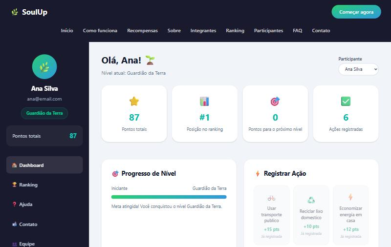
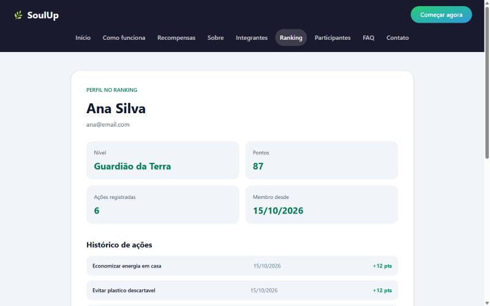
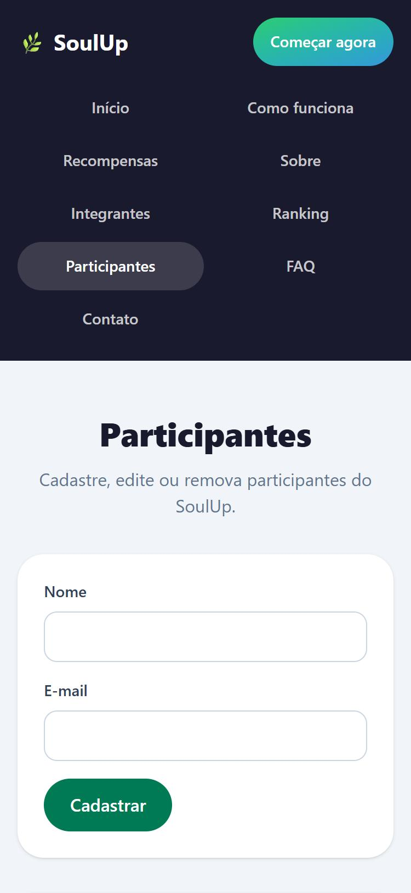

# 🌿 SoulUp | Challenge FIAP 2026 · Sprint 4

O SoulUp é uma plataforma de gamificação sustentável. O participante registra ações do dia a dia, como reciclar, economizar água ou usar bicicleta. Cada ação vale pontos, e os pontos definem o nível dele e a posição no ranking.

Na **Sprint 4**, o front-end em React consome a **API REST em Java (Spring Boot)** da equipe. A API salva participantes, ações e pontos em um banco **Oracle**.

## Sumário

- [Como usar](#como-usar)
- [Tecnologias](#tecnologias)
- [Funcionalidades](#funcionalidades)
- [Integração com a API](#integração-com-a-api)
- [Estrutura de pastas](#estrutura-de-pastas)
- [Rotas](#rotas)
- [Imagens](#imagens)
- [Autores](#autores)
- [Contato](#contato)

## Como usar

### Links

| O quê | Link |
| --- | --- |
| Repositório no GitHub | https://github.com/LuigiT2703/challenge-sem02-front |
| Site publicado (Vercel) | **COLOCAR_URL_DA_VERCEL** |
| API Java publicada (Render) | https://soulup-api-g73n.onrender.com |
| Vídeo no YouTube (Sprint 4) | **COLOCAR_LINK_DO_VIDEO** |

> A API está no plano gratuito do Render. Por isso, a primeira consulta pode levar cerca de 1 minuto: o servidor fica parado e precisa iniciar. Enquanto isso, as telas mostram "Carregando...".

### Rodar localmente

Pré-requisitos: Node.js 20.19+ (ou 22.12+) e npm.

```bash
git clone https://github.com/LuigiT2703/challenge-sem02-front.git
cd challenge-sem02-front/SoulUp
cp .env.example .env
npm ci
npm run dev
```

Abra `http://localhost:5173`. O arquivo `.env` define a URL da API:

```env
VITE_API_URL=https://soulup-api-g73n.onrender.com
```

Outros comandos: `npm run build` (gera o build e confere os tipos) e `npm run lint`.

### Roteiro de uso

1. Em **Participantes**, cadastre seu nome e e-mail. Você vai para o seu perfil, com uma mensagem de sucesso.
2. No **Dashboard**, escolha seu nome e clique em uma ação para registrar. Os pontos, o nível e a posição são atualizados na hora. Para remover um registro, use "Desfazer".
3. Em **Ranking**, veja a classificação geral. Clique em um nome para abrir o perfil em `/ranking/:id`.
4. Em **Participantes**, você também pode editar ou excluir cadastros.

## Tecnologias

| Tecnologia | Uso |
| --- | --- |
| React 19 + Vite 8 | Interface (SPA) e build |
| TypeScript 6 | Tipagem de props, dados da API e estados |
| Tailwind CSS 4 | Estilo e responsividade (`sm:`, `md:`, `lg:`, `xl:`) |
| React Router 8 (`react-router`) | Rotas estáticas, rota dinâmica e página 404 |
| React Hook Form | Formulário de contato e busca do FAQ |
| `fetch` nativo | Chamadas à API (sem axios) |
| Vercel | Hospedagem do front-end |

Não usamos Bootstrap, MUI, Chakra, jQuery, axios nem template pronto.

## Funcionalidades

- **Dashboard:** escolha do participante; registrar e desfazer ações (POST e DELETE `/registros`); pontos, nível, posição no ranking e conquistas.
- **Ranking:** classificação real (GET `/ranking`), com pódio e filtro por nível.
- **Perfil `/ranking/:id`:** dados e histórico do participante (GET `/usuarios/{id}` e `/usuarios/{id}/registros`). Um id que não existe mostra a tela "não encontrado".
- **Participantes:** CRUD completo (GET, POST, PUT e DELETE `/usuarios`). Depois de salvar, redireciona para o perfil com `useNavigate` e uma mensagem.
- **Telas de estado:** toda tela que usa a API mostra "carregando", "erro" com o botão "Tentar novamente" e "lista vazia".
- **Páginas institucionais:** Home, Como funciona, Recompensas, Sobre, FAQ, Contato e Integrantes.

## Integração com a API

Todas as chamadas ficam em `src/services/`:

| Arquivo | O que faz |
| --- | --- |
| `api.ts` | Função `requisicao<T>()` com `fetch`. Lê `VITE_API_URL`, converte o erro da API (`{ status, mensagem }`) em `ApiError` |
| `usuarioService.ts` | Listar, ranking, buscar, registros, criar, atualizar e excluir participante |
| `acaoService.ts` | Listar (com filtro por categoria), buscar, criar, atualizar e excluir ação |
| `registroService.ts` | Registrar e desfazer ação |

Os tipos da API ficam em `src/types/api.ts`:

- **Interfaces:** `Usuario`, `Acao` e `RegistroAcao`.
- **Union types:** `Categoria`, `Nivel` e `EstadoRequisicao<T>`, que pode ser `carregando`, `erro` ou `sucesso`.
- **Intersection type:** `UsuarioComRegistros = Usuario & { registros }`.

O hook `useRequisicao` controla os estados de cada tela.

## Estrutura de pastas

```text
challenge-sem02-front/
├── README.MD
└── SoulUp/
    ├── .env.example          # VITE_API_URL
    ├── vercel.json           # rewrite das rotas para index.html
    ├── docs/imagens/         # capturas da aplicação
    ├── public/equipe/        # fotos dos integrantes
    └── src/
        ├── components/       # cabeçalho, rodapé, cards, painéis e EstadoTela
        ├── data/             # prêmios
        ├── hooks/            # useRequisicao
        ├── pages/            # uma pasta por página
        ├── services/         # chamadas à API com fetch
        ├── types/            # tipos da API
        ├── utils/            # formatarData
        ├── App.tsx           # layout com Outlet
        └── main.tsx          # rotas
```

## Rotas

| Caminho | Página |
| --- | --- |
| `/` | Home |
| `/como-funciona` | Como funciona |
| `/sobre` | Sobre o projeto |
| `/equipe` | Integrantes |
| `/faq` | Perguntas frequentes |
| `/contato` | Contato |
| `/ranking` | Ranking (API) |
| `/ranking/:id` | Perfil do participante (rota dinâmica, API) |
| `/participantes` | Cadastro de participantes (API) |
| `/dashboard` | Dashboard (API) |
| `*` | Página não encontrada (404) |

## Imagens








## Autores

| Foto | Nome | RM | Turma | GitHub | LinkedIn |
| --- | --- | --- | --- | --- | --- |
|  | Cauã De Souza Vasconcellos | 573349 | 1TDSPH | [cauadesouzavasconcellos-byte](https://github.com/cauadesouzavasconcellos-byte) | [LinkedIn](https://www.linkedin.com/in/cauã-souza-b92261395) |
|  | Gabriel Tavares | 571113 | 1TDSPV | [gabristavares](https://github.com/gabristavares) | [LinkedIn](https://www.linkedin.com/in/gabrielst1005) |
|  | Leonardo De Souza Bernard | 570951 | 1TDSPV | [bernardleonardo](https://github.com/bernardleonardo) | [LinkedIn](https://www.linkedin.com/in/leonardo-de-souza-573306410) |
|  | Luigi Tormim Carqueijeiro | 572424 | 1TDSPH | [LuigiT2703](https://github.com/LuigiT2703) | [LinkedIn](https://www.linkedin.com/in/luigi-tormim-b64738393) |

## Contato

- **Cauã:** [cauadesouzavasconcellos@gmail.com](mailto:cauadesouzavasconcellos@gmail.com)
- **Gabriel:** [gabriel.stavares05@gmail.com](mailto:gabriel.stavares05@gmail.com)
- **Leonardo:** [sbleonardo@icloud.com](mailto:sbleonardo@icloud.com)
- **Luigi:** [luigitormim27@gmail.com](mailto:luigitormim27@gmail.com)

Projeto acadêmico do Challenge FIAP 2026 em parceria com a SoulUp.
